# The Methods tab
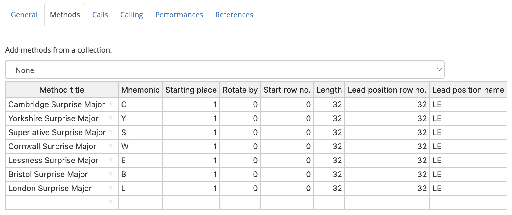

The Methods tab is a table which allows you to define the methods which are used in a custom composition. Every composition must have at least one method definition. 

To edit any value in the table, simply click on the relevant cell, then type a new value. Multiple cells can be highlighted by clicking and dragging. Alternatively, you can click on a cell, hold <kbd>Shift</kbd>, and then click on another cell to highlight a rectangle with those cells at opposite corners.

If you have filled out the [Title](adding_compositions_tabs_general.md/#title) field under the [General tab](adding_compositions_tabs_general.md), then the Methods tab may already be populated with one or more entries.

!!! note "Dynamic methods"
    For a [Dynamic method](../methods/dynamic_methods.md/#dynamic-methods-in-compositions), Start row number and Length cannot be used, and the only lead position allowed is the lead end (row number 0). The method may be rung with different [Trigger bells](#trigger-bells), and its leads may be framed differently using [Lead ends](#lead-ends).

## Method title
To manually add methods to the table, begin typing its title in the [Method title](#method-title) column. As you type, Complib will attempt to auto-complete with the titles of any matching public methods, or private methods which you own. 

Once a recognised method title has been entered, the rest of the cells in the row will auto-populate with default values appropriate to that method.

### Deleting methods
Deleting a method's name in the table will delete all its associated information as well. 

!!! warning "Warning: Replacing methods"
    It is best practice to delete a method from the table before replacing it with another, instead of simply changing the method name. **Changing the name will not automatically update the rest of the table to match the default entries for the new method.** This can result in peculiar behaviour, e.g. a treble-dodging method with the Length of a plain method, or vice versa.

### Adding methods from a collection
You can add methods directly from an existing method collection. This can be useful if you need to add a large number of methods to the tab.

To add methods from a collection, click on the dropdown menu above the methods table, then click on a method collection. The table will be populated with all the methods in that collection.

It's possible to add methods from multiple collections in this way, though the methods must all be at the same stage for this to work.

Methods already in the table will not be duplicated if they are added again via collection. **If you want multiple copies of a method, you must add them manually.**

## Mnemonic
A method mnemonic is a code of one to four characters which is used to represent the method in the composition's [layout](overview.md/#layout). Mnemonics are displayed by default in compositions of spliced, but they can be enabled for any composition by selecting **Columns > Method mnemonics** in the [composition layout options](layout_options.md).

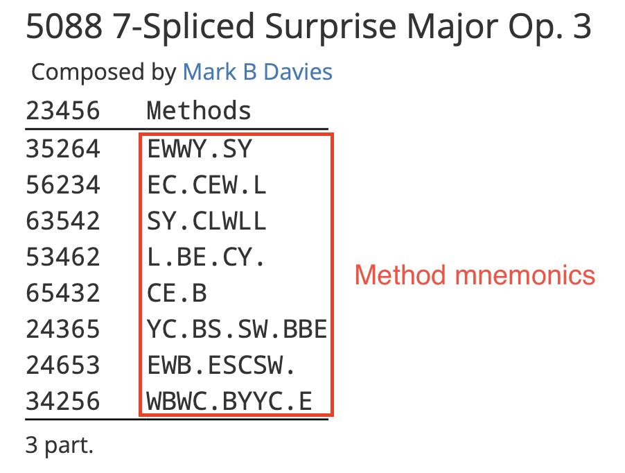{width="400"}

!!! warning "Mnemonic restrictions"
    Method mnemonics must have an uppercase letter [A–Z] as their first character. This may be optionally followed by up to three characters, each of which is a lowercase letter [a–z] or number [0–9]. For example, B, Bc, B2 and Bris are all valid mnemonics.

    Because a mnemonic can end with numbers, use a space to separate a mnemonic from a following repeat count in a method calling. For example, `B 2(C)` is a lead of B followed by two leads of C, whereas `B2(C)` is an error.

    Method mnemonics must be unique. If two methods used in a composition have the same mnemonic, it will cause an error.

### Default mnemonics
When a method is added to the Methods tab, its mnemonic will be the **first letter in its title** by default. Any numbers and special characters at the beginning of the title will be ignored. For example, ['ogwash Delight Minor](https://complib.org/method/30148) has a default mnemonic of "O".

Deleting a method's mnemonic from the table will reset the mnemonic to its default value.

If a method is given a mnemonic which is different from its default in a composition of spliced, then the mnemonic will be appended to the method's name at the bottom of the composition layout.

## Starting place
This field defines the row position above which the changes of the method will be applied. In effect, this defines where the "front" of the change is when ringing the specified method. 

Bells in positions which fall outside the bounds of the method will remain stationary whenever the method is rung in the composition.

??? note "Example"
    ---
    
    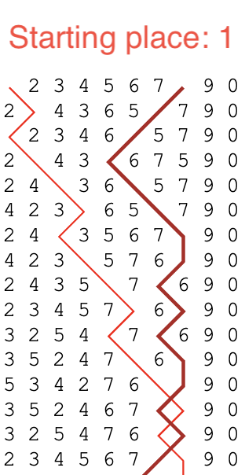{width="150"} &nbsp;&nbsp;&nbsp;&nbsp;&nbsp;
    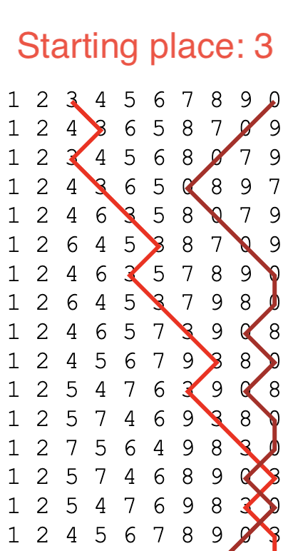{width="150"}

    These examples show the first half-lead of [Bristol Surprise Major](https://complib.org/method/19048) being rung on 10 bells, but with different starting places. Since the method's stage has 8 bells, there are two stationary bells.

!!! warning
    It is highly unlikely that you will ever need to adjust the Starting place value; it is currently only used in extremely rare types of composition.. In fact, it is **strongly recommended that you leave this value at 1 at all times.** 

??? warning "Warning: [Method name] (`__`) - Stage is higher than the composition's stage with a starting place of `__`."
    ---

    The starting place cannot cause the method to go outside the bounds of the composition's stage.
    
    The minimum starting place is 1. The maximum starting place is (*N* – *M* + 1), where *N* is the stage of the composition and *M* is the stage of the method.

    This means that it is only possible for a method to have a starting place greater than 1 when used in a composition whose stage is greater than its own, such as in **mixed-stage compositions**.

## Start row number
This field specifies which row of the method it should be started from. The default value is 0. Almost all methods are rung with a starting row of 0.

When a Start row number is specified, that many changes will be removed from the front of the first lead of the method. The removed changes are **not** reinserted elsewhere, and the leadend change remains the same. The changes in subsequent (consecutive) leads of the method are not affected. 

Whenenever a change-of-method results in this method being rung, this operation is applied again.

??? note "Example"
    ---

    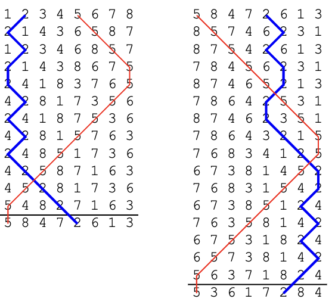{width="300"}

    The above diagram shows part of a composition of [Double Norwich Court Bob Major](https://complib.org/method/12470) in which the method's Start row number has been set to 4. Four changes have been removed from the first lead, resulting in a lead which is four rows shorter. 

### Starting each lead at a different row
On its own, a method's Start row number only affects where the method starts: the leads of the method still begin at its own leadhead. To start **every** lead of the method from a different row, as if the method's place notation were rotated, set the Start row number to that row and the [Lead ends](#lead-ends) to `L0`. The rows rung are the same either way. The difference is in which rows are treated as **leadheads and courseheads** when laying out the composition.

??? note "Example"
    ---

    In this example, a plain course of Grandsire Triples is being rung with a Start row number of 4.

    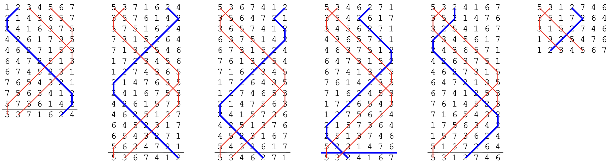

    In a blue line diagram, the rows which Complib considers leadheads have horizontal lines drawn above them by default. For coursehead rows, the lines are blue.

    When laid out by leads, the layout for this composition looks like this:

    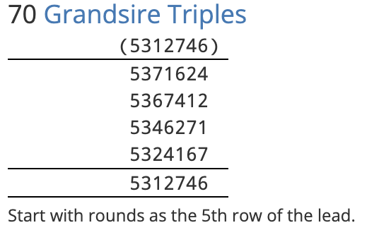{width="300"}

    ---

    If the Lead ends are also set to `L0`, each lead starts from the 5th row of the method instead, and the blue line diagram becomes:

    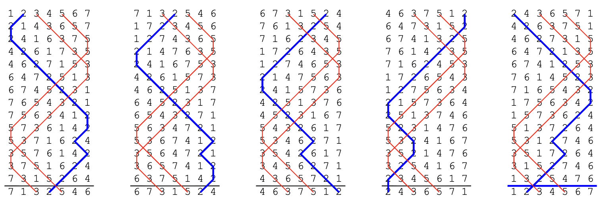

    And the corresponding layout:

    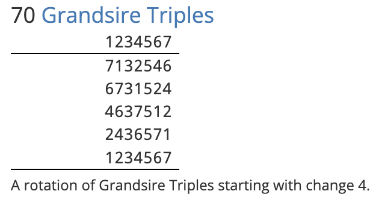{width="300"}

!!! note
    This changes the definition of a lead of the method. To start the whole composition from a different row, use the [Rotate](adding_compositions_tabs_general.md/#rotating-the-composition) transform in the General tab instead.

!!! warning 
    A method's Start row number should not be confused with the [composition's Start row number](adding_compositions_tabs_general.md/#start-row-number), which is set under the General tab. 
    
    The difference is that a method's Start row number is part of its definition, and will combine with other parts of the method's definition (such as [Length](#length) and [Lead position row number](#lead-position-row-number-and-name)) to determine how every lead of it in the composition is rung. 
    
    By contrast, a composition's Start row number affects only the first lead of the composition, and has no bearing on a method's definition.

    If **both** a method and the composition's Start row numbers are non-zero, then their effects may be combined. This can have unintended consequences. In almost all cases, it is only necessary to set one of them.

## Length
This value specifies how many changes are in each lead of the method. 

Whenever a lead of the method is reached in the composition, Complib will apply the method's changes in sequence until the number of rows in the lead is equal to the Length value.

By default, this value will be equal to the method's **Lead length**, which can be found under the [Properties tab](../methods/overview.md/#properties) on its method page.

??? warning "Warning: [Method name] (`__`) - The defined length (`__`) is greater than its lead length (`__`)."
    ---
    
    You should in almost all circumstances avoid using a Length value greater than the lead length of the method, as it can cause unnecessary confusion.

    If you want to have a partial lead of a method, there are multiple ways of achieving the same effect:

    1. You can define a special call, called a **trim**, which removes a number of changes from a lead of the method. See [Calls](adding_compositions_tabs_calls.md) for help with using trims.
    2. You can define a second instance of the same method in the Methods table with a Length that is less than its Lead length. If so, you will need to give this instance a unique [method mnemonic](#mnemonic), and indicate a change-of-method at the appropriate place in the [Calling](adding_compositions_tabs_calling.md).

??? error "Error: [Method name] (`__`) - Length must be greater than zero."
    ---

    Self-explanatory.

## Trigger bells
This column only applies to [Dynamic methods](../methods/dynamic_methods.md), and must be left blank for other methods. It shows the method's **trigger bells**: the bells used in the [conditions](../methods/dynamic_methods.md/#conditions) of its conditional notation, in ascending order. For example, the trigger bells of Dixon's Minor (`-{h}12{1}|14{2,4}16`) are `124`.

To ring the method with different trigger bells, replace each bell in place, keeping the same number of bells. Every condition of the method is changed in the same way. For example, changing `124` to `134` for Dixon's Minor replaces the 2 by the 3, so that 4ths are made at backstroke when the 3rd or 4th is leading. Each bell may only be used once.

The method with its trigger bells replaced is rung and analysed in its own right (for example, for truth and the leadheads it produces), but it is still the same method in the composition, and is shown with its original title. A note below the layout describes the change, e.g. *Dixon's Minor with trigger bell 2 replaced by 3*, preceded by the method's mnemonic where more than one method is used.

The same method can be given more than one mnemonic with different trigger bells. A change between them counts as a change of method, so the composition is treated as spliced and its layout shows the mnemonics by default.

Clear the field, or enter the method's own trigger bells, to restore the method as defined.

??? error "Error: [Method name] (`__`) - Trigger bells '`__`' must have `__` bells, one to replace each of `__`."
    ---

    The trigger bells must have the same number of bells as the method's own trigger bells, and each bell must be a bell of the stage and used only once.

??? error "Error: [Method name] (`__`) - Trigger bells '`__`' do not give a valid method."
    ---

    With the trigger bells replaced, the plain course of the method does not come round, or a row is reached where none of its clauses can be rung.

??? error "Error: [Method name] (`__`) - Trigger bells can only be set for a Dynamic method."
    ---

    Self-explanatory.

## Lead ends
This field sets where the leads of the method end in the composition, **without changing the changes rung**. It changes only where the lines are drawn in the blue line, which rows are treated as leadheads (and so courseheads and calling positions), and how leads are counted in the layout and when using [numbered calling positions](adding_compositions_tabs_calling.md). Leave it blank to use the lead ends recorded for the method.

When a valid value is entered, it is shown in a standard form when the composition is validated, e.g. `l12,6` is shown as `L0,6`.

### Leads and divisions
Composers divide the rows of a method into fixed blocks, which are joined either by calls or without them (plains) to build longer true touches. For most methods we call these blocks *leads*; for principles such as Stedman we call them *divisions*. Conventionally, a line is drawn between blocks where they join.

When a composition is presented by leads, only the first row of each block, the *leadhead*, is shown, and the other rows are hidden to keep the layout short. When it is presented by divisions, only the last row of each block is shown: the *division end*, or *six end* in Stedman. When the same composition is presented by courses, only the *course head* (the first leadhead of each course) or the *course end* (the last division end of each course) is shown.

In Complib, a method normally rung by divisions has its divisions recorded with the method. Counting rounds as row 0, Stedman is recorded as divisions of six rows, ending after rows 2 and 8. A method with no recorded divisions is rung by leads: rounds is the first leadhead, and ringing all the changes of the method produces the next one.

This structure also determines how Complib counts leads. The lead number goes up at each line between blocks, i.e. after a division end or before a leadhead. It goes back to 1 at each course end (by divisions) or course head (by leads). [Numbered calling positions](adding_compositions_tabs_calling.md), such as `–3` for a bob in the third lead or division, use these lead numbers. Calling positions such as W, B and H are found from the observation bell instead.

For the great majority of compositions this structure is all that is needed. Some compositions, however, need the rows divided into blocks differently from the method's own leads or divisions, for example:

- methods rotated, e.g. so that the treble's snap is the lead end: [5040 Spinning Jennie Delight Royal](https://complib.org/composition/33336)
- a method spliced with itself, restarting part way through a lead: [720 Double College Bob Minor](https://complib.org/composition/56966)
- half-lead spliced, where it is simpler to number the blocks by half-leads: [1280 5-Spliced Surprise Major](https://complib.org/composition/117809)
- calls at both the lead end and the half-lead: [5024 Bristol Surprise Major](https://complib.org/composition/75722)
- spliced compositions using fragments of a method's lead of different lengths: [5076 Spliced Royal](https://complib.org/composition/33445)
- variable hunt compositions: [5040 Grandsire Variable Treble Triples](https://complib.org/composition/76060)
- methods rung by leads spliced with methods rung by divisions, to avoid lines shown above and below a leadhead: [5000 2-Spliced Triples and Major](https://complib.org/composition/136170)
- methods recorded with divisions presented by leads, or vice versa: [5040 Carter Triples](https://complib.org/composition/141725)
- methods with divisions structured differently: [1260 Carter Triples](https://complib.org/composition/141415)
- Dynamic methods with different lead end conditions: [720 Reverse Dixon's Minor](https://complib.org/composition/170130)

The Lead ends field gives the method the structure the composition needs, as described below.

### Static methods
For a static (non-Dynamic) method, enter **L** (by leads) or **D** (by divisions), followed by a comma-separated list of row numbers in the lead. Row numbers are counted from the method's [Start row number](#start-row-number), in the same way as the [Lead position row number](#lead-position-row-number-and-name), so changing the Start row number moves the lead ends with it.

L
:   Each row given is a **leadhead**: the line is drawn above it. For example, `L0` makes the row the method starts from the leadhead, and `L0,6` in a Minor method with a lead of 12 changes divides each lead into two leads of six changes. `L` alone uses the method's own leadheads, and is useful for ringing a method recorded with divisions by leads instead.

D
:   Each row given is a **division end**: the line is drawn below it. For example, `D5,11` in Plain Bob Minor divides each lead at the half-lead and lead end. `D` alone uses the divisions recorded for the method, e.g. the sixes of Stedman.

Row numbers may be from 0 to the lead length. The lead length is the same row as 0, so `L12` is the same as `L0` for a lead of 12 changes, and the two can't both be given.

??? note "Example: starting each lead at a different row"
    ---

    Below are the plain courses of [Double Court Bob Minor](https://complib.org/method/11118) as recorded, and with each lead starting at the 6th row of the method. Lines are drawn through bell number 2, as well as the hunt bell in each case.

    **Start row number 0, Lead ends blank**&nbsp;&nbsp;&nbsp;&nbsp;&nbsp;`-14-36-16-36-14-16`

    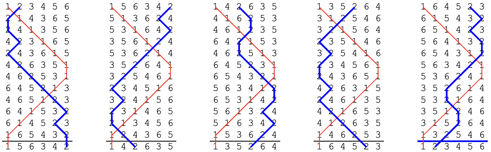

    ---

    **Start row number 5, Lead ends `L0`**&nbsp;&nbsp;&nbsp;&nbsp;&nbsp;`16-36-14-16-14-36-`

    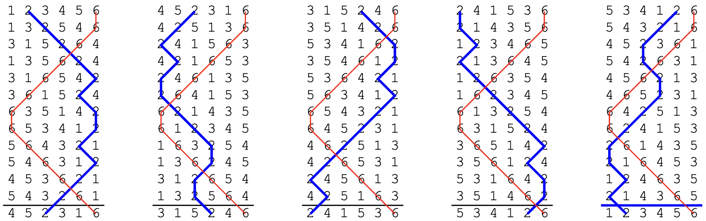

??? note "Example: spliced Stedman and Grandsire"
    ---

    In a composition of Stedman spliced with Grandsire, the Grandsire may be rung in fragments which start part of the way through a lead, each defined with its own mnemonic and [Start row number](#start-row-number), e.g. Ga with Start row number 2, Gb with 4, and so on. Giving each fragment the Lead ends `L0` makes the row it starts from a leadhead, so the fragment starts a new lead, and courses and calling positions are counted correctly.

Different lead ends do not make the method a different method. If the same method is given more than one mnemonic, and they differ only by their lead ends, a change between them which continues the method's changes is a change of mnemonic but not a [change of method](composition_properties.md/#miscellaneous), and the composition is not treated as spliced.

Lead ends of static methods are not described in the notes below the layout, as the lines can be seen in the blue line.

### Dynamic methods
For a [Dynamic method](../methods/dynamic_methods.md), the lead ends are given by a condition which replaces the method's own [lead end clauses](../methods/dynamic_methods.md/#lead-ends), written in the same way as a [condition in conditional notation](../methods/dynamic_methods.md/#conditions) without the braces. A lead ends wherever the condition is satisfied, between whichever clauses it happens to be.

Leadhead condition
:   A condition on the first row of each lead, e.g. `1xxxxxb` makes a leadhead wherever the treble leads at backstroke.

Leadend and leadhead conditions
:   Conditions on the rows either side of the line, written `leadend|leadhead`, e.g. `1xxxxxh|1xxxxxb` makes a leadhead only where the treble leads at handstroke and backstroke, i.e. at the end of its full lead. Either side may be left out, e.g. `1xxxxxh|` gives a condition on the leadend alone.

As in other conditions, trailing `x`s may be left out (e.g. `1b` for `1xxxxxb`), `h` or `b` requires a handstroke or backstroke row, `+` or `-` requires an even or odd row, and masks separated by commas are alternatives.

Calls at the lead end are made at the reframed lead ends: the call replaces the change into the reframed leadhead. If the method's [Trigger bells](#trigger-bells) are replaced, the lead ends condition is changed in the same way.

Lead ends of Dynamic methods are described in the notes below the layout, e.g. *Dixon's Minor with leadheads at 1b*.

### Lead ends warnings and errors
??? error "Error: [Method name] (`__`) - Lead ends '`__`' are not valid. Lead ends '`__`' of a Static method must be L (by leads) or D (by divisions) followed by rows counted from the start row, e.g. L0,6 or D2,8."
    ---

    Self-explanatory. Conditions such as `1xxxxxb` can only be used for a Dynamic method.

??? error "Error: [Method name] (`__`) - Lead ends '`__`' are not valid. Lead ends '`__`' must be rows from 0 to `__`."
    ---

    Each row number must be from 0 to the lead length of the method.

??? error "Error: [Method name] (`__`) - Lead ends '`__`' are not valid. Lead ends '`__`' contains row `__` more than once (row `__` is also row 0)."
    ---

    Each row may only be given once. Remember that the lead length is the same row as row 0.

??? error "Error: [Method name] (`__`) - Lead ends '`__`' are not valid. Lead ends '`__`' must give the rows ending each division, as the method has no recorded divisions."
    ---

    `D` alone can only be used for a method which has recorded divisions, such as Stedman. For other methods, give the rows which end each division.

??? error "Error: [Method name] (`__`) - Lead ends '`__`' are not valid. Lead ends '`__`' of a Dynamic method must be a condition on the leadhead, e.g. 1xxxxxb, or on the leadend and leadhead, e.g. 1xxxxxh|1xxxxxb."
    ---

    `L` and `D` can only be used for a static method.

## Lead position row number and name
These two values together define the location and name of a **Lead position**.

Lead position
:   A position within a lead of the method where a call can be applied.

The **Lead position row number** is the number of the row to which a call's change is applied, or to which the final change of the call is applied, if it has more than one.

??? note "Example: Cambridge S Minor with a halflead call"
    ---

    In this (rather contrived) example, an unusual call with place notation `12.36` is made at the half-lead of [Cambridge Surprise Minor](https://complib.org/method/14568). The call affects rows number 11 and 12 in the lead. The Lead position row number for the call is therefore 12.

    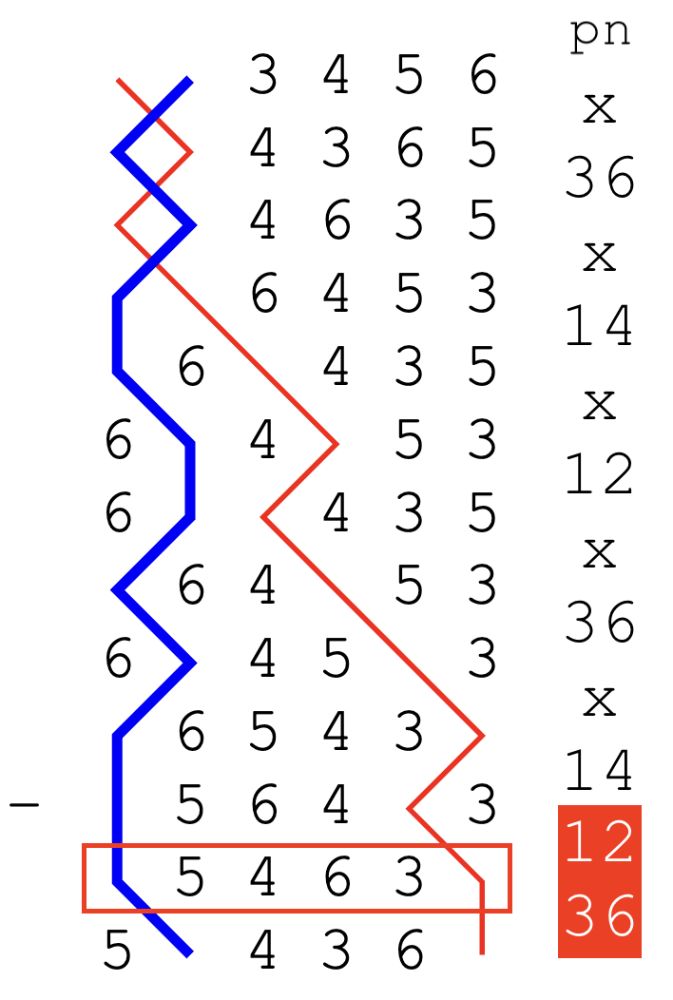{width="250"}

    The highlighted elements of the place notation are the ones caused by the call. The final change of the call affects row number 12, which has been marked in red.

By default, the Lead position row number will be equal to the method's Length value, since most calls occur at the end of a lead.

The **Lead position name** is an identifier which is used to refer to this Lead position in places such as a [call definition](adding_compositions_tabs_calls.md), and in the composition [layout](overview.md/#layout). 

The Lead position name can be any string of characters you like: you can even use emoji or other special symbols. The only requirement is that it must exactly match the name you use for that position in the [Calls tab](adding_compositions_tabs_calls.md).

The Lead position name will be included at the bottom of the composition layout as part of a call's definition. This means that, for example, the Lead position name can be used to name calls used in Doubles variations.

??? note "Example: Plain Bob with a Pink's Single"
    ---

    By naming the lead position "**Pink's**" in an an extent of Plain Bob Doubles with an appropriate [call definition](adding_compositions_tabs_calls.md), you get the variation May Day Doubles with the layout showing the call as:
    > **s = 145.345.123.345.145 Pink's Single**.

### Defining multiple Lead positions
It's possible to define multiple different Lead positions for the same method. To do this, enter a new Lead position row number and name in the table row beneath the original method definition. The rest of the row should be left blank.

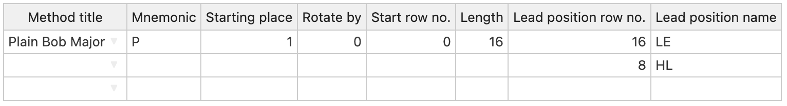

### Default Lead positions
Every method has a Lead position which Complib uses for it by default. Unlike custom Lead position names, default Lead position names will not be given in the composition's layout.

The default name and row number used depends on the method's type.

LE
:   Short for "lead end". This is the default Lead position for methods which are **hunters** (see [Method properties > Hunt bells](../methods/method_properties.md/#hunt-bells)). The default position is the final row of the lead.

SE
:   Short for "section end". This is the default Lead position for **principles**, which are methods with no hunt bells. The default row number is 1, the *first* row of the lead. 